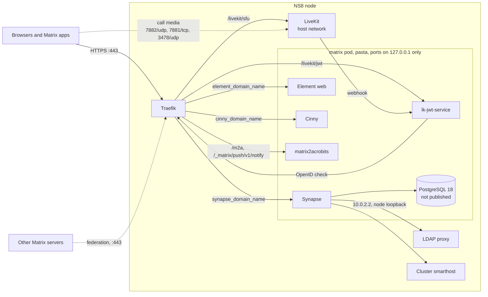

# ns8-matrix

:warning: This project is a proof of concept to evaluate Matrix integration with NethServer 8.
The goal is to provide a chat engine for NethVoice and NethCTI modules in the future, see [NethServer/dev#7648](https://github.com/NethServer/dev/issues/7648).
It is in early development and meant for testing only. Do not use it in production. :warning:

A NethServer 8 module for [Matrix](https://matrix.org/) chat, with LDAP authentication.
It runs the Synapse homeserver, the Element and Cinny web clients, and optionally
matrix2acrobits for NethVoice and LiveKit for Element Call.



Every container runs in one rootless pod, except LiveKit. LiveKit runs in the node network,
because call media must leave from the node address. Its media ports bypass Traefik. Legacy
one to one calls go directly between clients or through the external TURN server.

## Documentation

- [Admin guide](docs/admin-guide.md): all the parameters, web clients, LDAP, federation,
  TURN, Element Call with LiveKit, mail, secrets, backup and restore, update, uninstall.
- [Architecture](docs/architecture.md): network and ports, Traefik routes, systemd units,
  configuration rendering, module state, PostgreSQL migration.
- [NethVoice integration](docs/nethvoice.md): matrix2acrobits, push notifications and the
  roadmap.

## Install

```sh
add-module ghcr.io/nethserver/matrix:latest 1
```

The output returns the instance name, for example `matrix1`.

## Configure

Fill in the Settings page, or:

```sh
api-cli run module/matrix1/configure-module --data '{"synapse_domain_name": "matrix.example.com", "element_domain_name": "chat.example.com", "cinny_domain_name": "cinny.example.com", "lets_encrypt": true, "ldap_domain": "users.example.com"}'
```

`synapse_domain_name`, `lets_encrypt` and `ldap_domain` are required. A missing key falls
back to its default, not to the stored value, except `search_all_users` and
`turn_shared_secret`. Send the full configuration each time, see
[Parameters](docs/admin-guide.md#parameters).

Users log in with their LDAP account name and password.

## Uninstall

```sh
remove-module --no-preserve matrix1
```

## Running tests locally

This module uses the NS8 standard testing infrastructure. Refer to the
[Running tests locally](https://github.com/NethServer/ns8-github-actions/blob/v1/README.md#running-tests-locally)
section of the ns8-github-actions repository.

## UI translation

Translated with [Weblate](https://hosted.weblate.org/projects/ns8/).

To set up the translation process:

- add the [GitHub Weblate app](https://docs.weblate.org/en/latest/admin/continuous.html#github-setup) to your repository
- add your repository to [hosted.weblate.org](https://hosted.weblate.org) or ask a NethServer developer to add it to the ns8 Weblate project
