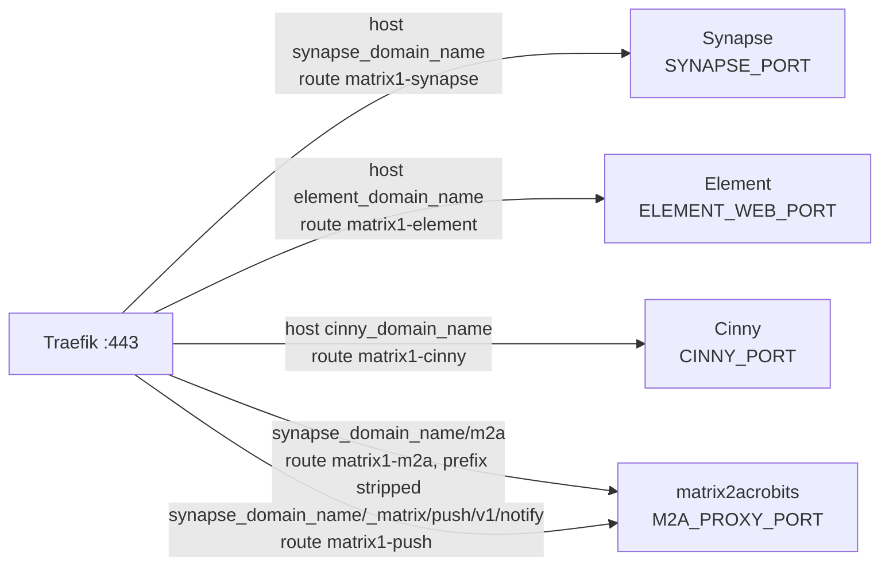
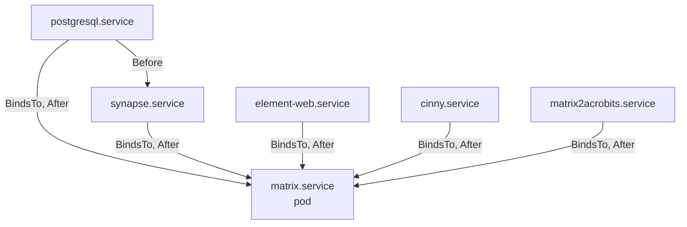
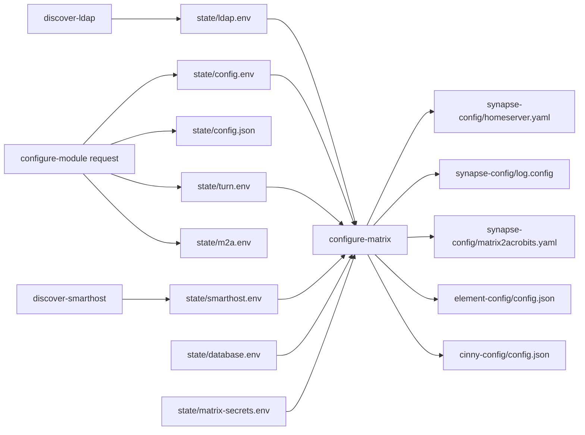
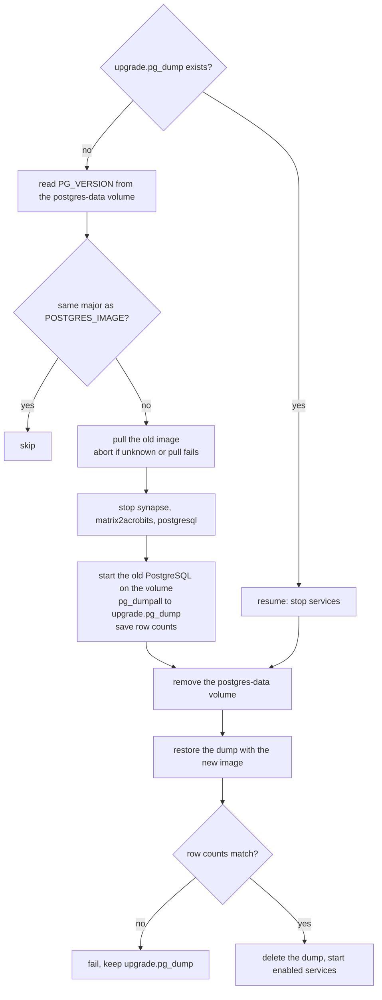

# Architecture

The module is rootless and runs one instance per node. Traefik is the entry point from
outside. It reaches every service on 127.0.0.1.

## Network

Every container runs in one rootless pod named `matrix`, created by `matrix.service`. The
containers reach each other on the pod loopback. The pod publishes four ports on 127.0.0.1
of the node:

| Service | Listens in the pod | Published on the node |
|---|---|---|
| Synapse | `SYNAPSE_PORT` (`bind_addresses` in `homeserver.yaml`) | `127.0.0.1:SYNAPSE_PORT` |
| PostgreSQL | `5432` | not published |
| Element web | `8080` | `127.0.0.1:ELEMENT_WEB_PORT` |
| Cinny | `80` | `127.0.0.1:CINNY_PORT` |
| matrix2acrobits | `M2A_PROXY_PORT` | `127.0.0.1:M2A_PROXY_PORT` |

The pod uses pasta with its own address, `10.0.2.100`. It keeps reaching the node IP, so a
NethVoice or a smarthost on the same node still answers. `--map-gw` makes the gateway
`10.0.2.2` lead to the node loopback. `discover-ldap` and `discover-smarthost` write `10.0.2.2`
when the user domain or the smarthost resolves to a loopback address on the node.

The pod publishes the Element, Cinny and matrix2acrobits ports even when these services are
off, because publishing is fixed when the pod is created. The Element image runs as a
non-root user and cannot bind port 80, so it listens on 8080 inside the pod.

Call media never goes through the module. Clients talk WebRTC to each other or through the
external TURN server.

## Ports

NS8 allocates 5 TCP ports (`org.nethserver.tcp-ports-demand=5`). `configure-module` assigns
them in this order:

| Index | Variable | Service |
|---|---|---|
| 0 | `SYNAPSE_PORT` | Synapse |
| 1 | `ELEMENT_WEB_PORT` | Element web |
| 2 | `CINNY_PORT` | Cinny |
| 3 | `POSTGRES_PORT` | unused since the pod, kept so the other indexes do not move |
| 4 | `M2A_PROXY_PORT` | matrix2acrobits |

## Traefik routes

The Synapse route always exists. The Element and Cinny routes exist when their domain name is
set. The two matrix2acrobits routes exist when `nethvoice_auth_url` is set. Otherwise
`configure-module` deletes them. All routes redirect HTTP to HTTPS and follow `lets_encrypt`.

With federation, Synapse adds the `federation` listener resource and serves
`/.well-known/matrix/server` on the same route.

## Systemd units

`matrix.service` creates the pod. Every container unit has `BindsTo=matrix.service` and
`After=matrix.service`: starting a container starts the pod first, and stopping or restarting
the pod stops or restarts the running containers. The pod does not start the containers, so
restarting Synapse alone, for example on `ldap-changed`, leaves the pod and the other
containers running. `80start_services` and `update-module.d/80restart_services` restart the
pod, then start each enabled container.

PostgreSQL counts as started only when its `ExecStartPost` loop can open the `synapse`
database, so Synapse finds the database ready.

`80start_services` enables `matrix`, `postgresql` and `synapse` always. It enables
`element-web` and `cinny` when their domain name is set, and `matrix2acrobits` when
`nethvoice_auth_url` is set. The others are disabled and stopped.

The first update to the pod runs `update-module.d/06stop_before_pod`, after the PostgreSQL upgrade. It stops the old
containers, which hold the ports the pod publishes, and the old oneshot `matrix.service`.

Each unit runs scripts as `ExecStartPre`:

| Unit | Scripts |
|---|---|
| `synapse.service` | `discover-ldap`, `discover-smarthost`, `configure-matrix`, then `synapse generate` |
| `postgresql.service`, `element-web.service`, `cinny.service`, `matrix2acrobits.service` | `configure-matrix` |

## Configuration rendering

`20configure` validates the request, writes `config.env`, `config.json` and `turn.env`, sets
the Traefik routes and writes `m2a.env` for matrix2acrobits. It does not render the service
configuration.

`configure-matrix` renders the files in `templates/` with the values of the env files. It
creates `database.env` and `matrix-secrets.env` when they are missing. It runs before every
service start, so the rendered files always match the templates of the current image. Manual
changes to them are lost.

## Module state

| File or volume | Written by | In the backup |
|---|---|---|
| `config.env` | `configure-module` | no, rebuilt from `config.json` |
| `config.json` | `configure-module` | yes |
| `turn.env` | `configure-module` | yes |
| `m2a.env` | `configure-module` | no, rebuilt from `config.json` |
| `database.env` | `configure-matrix` | yes |
| `matrix-secrets.env` | `configure-matrix` | no, regenerated |
| `ldap.env` | `discover-ldap` | no, rediscovered |
| `smarthost.env` | `discover-smarthost` | no, rediscovered |
| rendered configs | `configure-matrix` | no, rendered again |
| `postgresql.pg_dump` | `module-dump-state` | yes |
| `postgres-data` volume | PostgreSQL | no, the dump is used |
| `synapse-data` volume | Synapse | yes |
| `matrix2acrobits-data` volume | matrix2acrobits | yes |

The list of backed up paths is in `etc/state-include.conf`.

## Events

| Event | Handler |
|---|---|
| `ldap-changed` | restarts `synapse.service` |
| `smarthost-changed` | restarts `synapse.service`, the unit has no reload command |

## PostgreSQL migration

`update-module.d/05database_upgrade` runs before the services restart on update.

The old images are listed in `old_images`. When bumping the PostgreSQL major version, add the
image the module shipped before the bump. Up to PostgreSQL 17 the data sits at the volume root,
from 18 under `<major>/docker`. The script reads `PG_VERSION` from the host side, because
mounting the volume with `:Z` in a helper container would lock out a running PostgreSQL.
