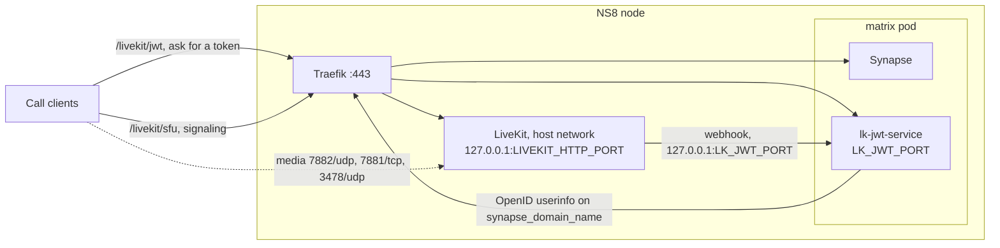
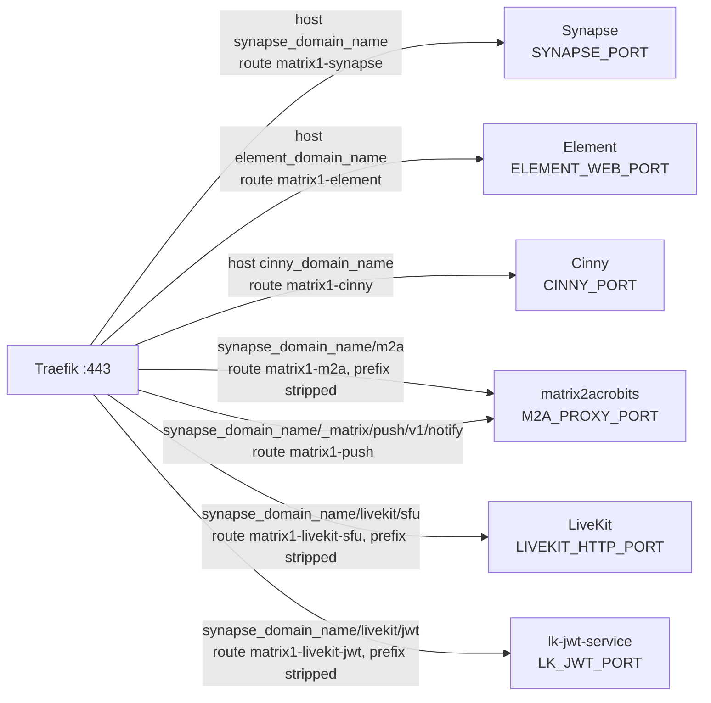
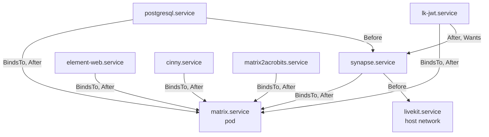
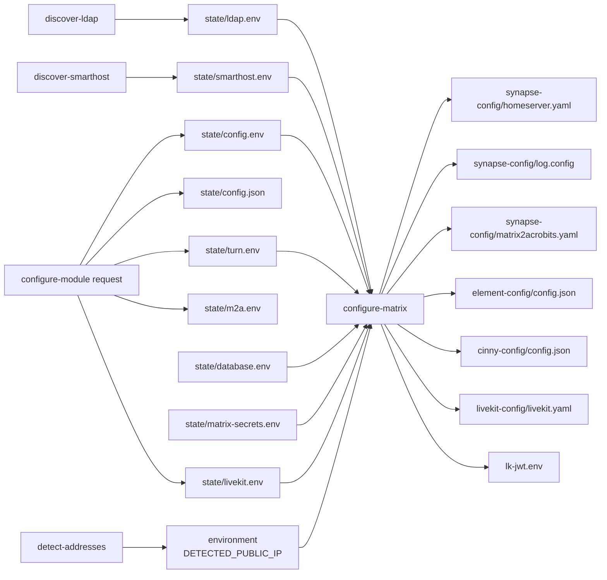
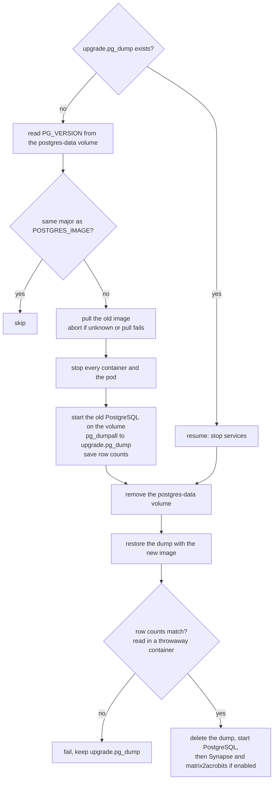

# Architecture

The module is rootless and runs one instance per node. Traefik is the entry point from
outside. It reaches every service on 127.0.0.1.

## Network

Every container runs in one rootless pod named `matrix`, created by `matrix.service`. The
containers reach each other on the pod loopback. LiveKit is the only exception, see below.
The pod publishes these ports on 127.0.0.1 of the node:

| Service | Listens in the pod | Published on the node |
|---|---|---|
| Synapse | `SYNAPSE_PORT` (`bind_addresses` in `homeserver.yaml`) | `127.0.0.1:SYNAPSE_PORT` |
| PostgreSQL | `5432` | not published |
| Element web | `8080` | `127.0.0.1:ELEMENT_WEB_PORT` |
| Cinny | `80` | `127.0.0.1:CINNY_PORT` |
| matrix2acrobits | `M2A_PROXY_PORT` | `127.0.0.1:M2A_PROXY_PORT` |
| lk-jwt-service | `LK_JWT_PORT` | `127.0.0.1:LK_JWT_PORT` |

The pod uses pasta with its own address, `10.0.2.100`. It keeps reaching the node IP, so a
NethVoice or a smarthost on the same node still answers. `--map-gw` makes the gateway
`10.0.2.2` lead to the node loopback. `discover-ldap` and `discover-smarthost` write `10.0.2.2`
when the user domain or the smarthost resolves to a loopback address on the node.

The pod publishes the Element, Cinny and matrix2acrobits ports even when these services are
off, because publishing is fixed when the pod is created. The Element image runs as a
non-root user and cannot bind port 80, so it listens on 8080 inside the pod.

Legacy one to one calls never go through the module. Clients talk WebRTC to each other or
through the external TURN server.

LiveKit runs outside the pod, in the node network namespace, like the BigBlueButton media
server. Call media must leave from the node address, and pasta would rewrite it. It listens
on the node:

| Port | Bound to | Firewall |
|---|---|---|
| `LIVEKIT_HTTP_PORT`/tcp, signaling and API | `127.0.0.1` | closed, Traefik publishes it |
| 7881/tcp, media when UDP is blocked | every address | open while `livekit_enabled` is true |
| 7882/udp, media | every address | open while `livekit_enabled` is true |
| 3478/udp, TURN relay | every address | open while `livekit_turn_enabled` is true |
| `UDP_PORTS_RANGE`, TURN relay to the SFU | every address | closed |

The media ports are opened through `add_public_service`.

lk-jwt-service checks the OpenID token of the user through the public Synapse URL, so it
goes out through Traefik. LiveKit reaches lk-jwt-service on the port the pod publishes on
127.0.0.1.

## Ports

NS8 allocates 6 TCP ports (`org.nethserver.tcp-ports-demand=6`). `configure-module` assigns
them in this order:

| Index | Variable | Service |
|---|---|---|
| 0 | `SYNAPSE_PORT` | Synapse |
| 1 | `ELEMENT_WEB_PORT` | Element web |
| 2 | `CINNY_PORT` | Cinny |
| 3 | `LIVEKIT_HTTP_PORT` | LiveKit signaling and API, 127.0.0.1. Was `POSTGRES_PORT` before the pod |
| 4 | `M2A_PROXY_PORT` | matrix2acrobits |
| 5 | `LK_JWT_PORT` | lk-jwt-service |

NS8 also allocates 1024 UDP ports (`org.nethserver.udp-ports-demand=1024`), in
`UDP_PORTS_RANGE`. They are the LiveKit TURN relay range, `turn.relay_range_start/end` in
`livekit.yaml`. Each client that goes through the TURN relay holds about two of them during a
call. The relay only talks to the local SFU, so the range stays closed in the firewall.
Without it LiveKit binds 30000-40000/udp on the host, inside the range NS8 gives to other
modules such as NethVoice or BigBlueButton. The range is reserved even with TURN off.

An instance installed before LiveKit has 5 TCP ports and no UDP port. The core stores the new
demand on update but allocates nothing, so `bin/apply-livekit-ports` allocates the missing TCP
port and the UDP range once, and stores them in the module environment. It runs from
`update-module.d/02livekit_ports` and again on every `configure-module`. When the node has no
1024 free UDP ports, it logs a warning, `configure-module` refuses to enable the TURN and
`configure-matrix` keeps it off. A restore or a clone gets new ports from `add-module` on the
target node.

The LiveKit media ports are fixed, outside the NS8 allocator: 7881/tcp, 7882/udp, and
3478/udp with TURN. The router forward then survives a restore, a clone or a move to another
node. `bin/port-owner` refuses to enable LiveKit or its TURN when another application holds
one of them.

## Traefik routes

The Synapse route always exists. The Element and Cinny routes exist when their domain name is
set. The two matrix2acrobits routes exist when `nethvoice_auth_url` is set. The two LiveKit
routes exist when `livekit_enabled` is true. Otherwise
`configure-module` deletes them. All routes redirect HTTP to HTTPS and follow `lets_encrypt`.

With federation, Synapse adds the `federation` listener resource and serves
`/.well-known/matrix/server` on the same route. With LiveKit and no federation, it adds the
`openid` resource instead and still serves the server well-known: lk-jwt-service finds the
OpenID userinfo endpoint through it. Synapse also appends `templates/synapse-livekit.yaml`:
`matrix_rtc` transports, `msc4143_enabled`, the `rtc_foci` client well-known for Cinny,
delayed events and the rate limits Element Call needs.

## Systemd units

`matrix.service` creates the pod. Every container unit has `BindsTo=matrix.service` and
`After=matrix.service`: starting a container starts the pod first, and stopping the pod stops
every container. Once the pod runs, its `ExecStartPost` starts each enabled container without
waiting, so the containers come back after a pod crash. The pod has no `Requires=` on the
containers, so restarting Synapse alone, for example on `ldap-changed`, leaves the pod and the
other containers running.

`livekit.service` is not in the pod and is not bound to it, so a pod restart leaves it
running. `80start_services` and `update-module.d/80restart_services` restart it, and
`lk-jwt.service`, so they always load the new configuration.

`80start_services` stops the disabled clients, restarts the pod, then starts PostgreSQL,
Synapse and the enabled clients. `update-module.d/80restart_services` does the same when
`synapse.service` is enabled, and does nothing otherwise.

PostgreSQL counts as started only when its `ExecStartPost` loop can open the `synapse`
database, so Synapse finds the database ready.

`80start_services` enables `matrix`, `postgresql` and `synapse` always. It enables
`element-web` and `cinny` when their domain name is set, `matrix2acrobits` when
`nethvoice_auth_url` is set, and `lk-jwt` and `livekit` when `livekit_enabled` is true. The
others are disabled and stopped.

The first update to the pod runs `update-module.d/06stop_before_pod`, after the PostgreSQL
upgrade. It stops the old containers, which hold the ports the pod publishes, and the old
oneshot `matrix.service`.

Each unit runs scripts as `ExecStartPre`:

| Unit | Scripts |
|---|---|
| `synapse.service` | `discover-ldap`, `discover-smarthost`, `configure-matrix`, then `synapse generate` |
| `postgresql.service`, `element-web.service`, `cinny.service`, `matrix2acrobits.service`, `lk-jwt.service`, `livekit.service` | `configure-matrix` |

## Configuration rendering

`20configure` validates the request, writes `config.env`, `config.json` and `turn.env`, sets
the Traefik routes and writes `m2a.env` for matrix2acrobits. It does not render the service
configuration. With LiveKit on, `30livekit` creates `livekit.env` with the API key and secret
once, sets the LiveKit routes, and runs `detect-addresses` when `livekit_public_address` is
empty. `detect-addresses` stores `DETECTED_PUBLIC_IP` in the module environment.

`configure-matrix` renders the files in `templates/` with the values of the env files. It
creates `database.env` and `matrix-secrets.env` when they are missing. It runs before every
service start, so the rendered files always match the templates of the current image. Manual
changes to them are lost. With LiveKit on, it also appends `synapse-livekit.yaml` to
`homeserver.yaml`, sets `element_call.use_exclusively` in the Element configuration and
writes `livekit.yaml` and `lk-jwt.env`. LiveKit announces `livekit_public_address`, or
`DETECTED_PUBLIC_IP` when it is empty.

## Module state

| File or volume | Written by | In the backup |
|---|---|---|
| `config.env` | `configure-module` | no, rebuilt from `config.json` |
| `config.json` | `configure-module` | yes |
| `turn.env` | `configure-module` | yes |
| `m2a.env` | `configure-module` | no, rebuilt from `config.json` |
| `livekit.env` | `configure-module` | yes |
| `lk-jwt.env` | `configure-matrix` | no, rendered again |
| `database.env` | `configure-matrix` | yes |
| `matrix-secrets.env` | `configure-matrix` | no, regenerated |
| `ldap.env` | `discover-ldap` | no, rediscovered |
| `smarthost.env` | `discover-smarthost` | no, rediscovered |
| rendered configs | `configure-matrix` | no, rendered again |
| `postgresql.pg_dump` | `module-dump-state` | yes |
| `postgres-data` volume | PostgreSQL | no, the dump is used |
| `synapse-data` volume | Synapse | yes |
| `matrix2acrobits-data` volume | matrix2acrobits | yes |

The list of backed up paths is in `etc/state-include.conf`.

## Events

| Event | Handler |
|---|---|
| `ldap-changed` | restarts `synapse.service` |
| `smarthost-changed` | restarts `synapse.service`, the unit has no reload command |

## PostgreSQL migration

`update-module.d/05database_upgrade` runs before the services restart on update.

The row counts are read in a throwaway PostgreSQL container: starting `postgresql.service`
would start the pod, which starts Synapse on a database not yet checked.

The old images are listed in `old_images`. When bumping the PostgreSQL major version, add the
image the module shipped before the bump. Up to PostgreSQL 17 the data sits at the volume root,
from 18 under `<major>/docker`. The script reads `PG_VERSION` from the host side, because
mounting the volume with `:Z` in a helper container would lock out a running PostgreSQL.
