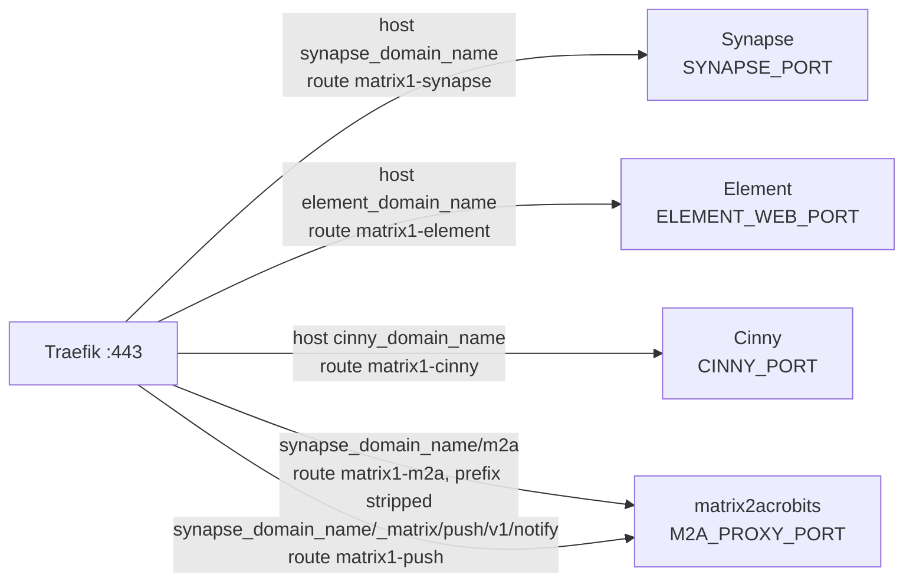
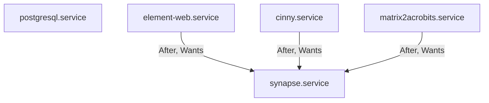
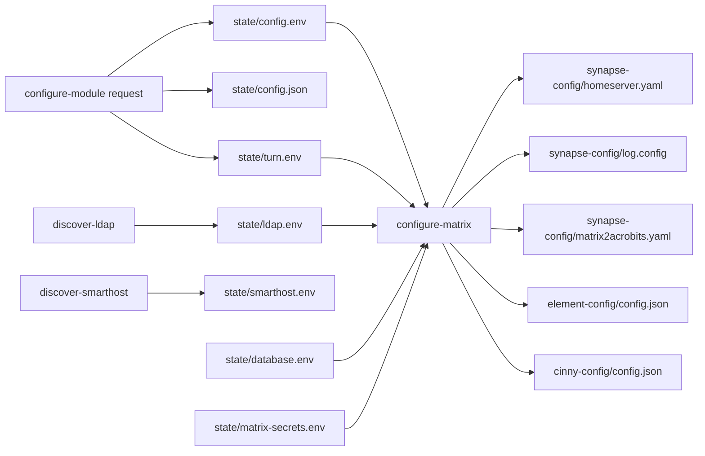
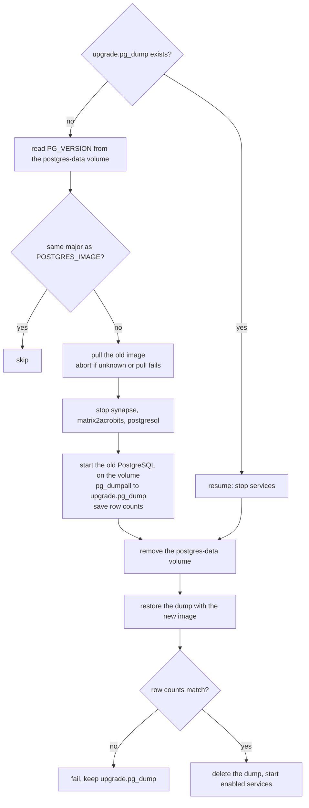

# Architecture

The module is rootless and runs one instance per node. All containers use host networking or
publish on the loopback ports NS8 allocates to the module. Traefik is the only entry point
from outside.

## Ports

NS8 allocates 5 TCP ports (`org.nethserver.tcp-ports-demand=5`). `configure-module` assigns
them in this order:

| Index | Variable | Service |
|---|---|---|
| 0 | `SYNAPSE_PORT` | Synapse |
| 1 | `ELEMENT_WEB_PORT` | Element web |
| 2 | `CINNY_PORT` | Cinny |
| 3 | `POSTGRES_PORT` | PostgreSQL |
| 4 | `M2A_PROXY_PORT` | matrix2acrobits |

## Traefik routes

The Synapse route always exists. The Element and Cinny routes exist when their domain name is
set. The two matrix2acrobits routes exist when `nethvoice_auth_url` is set. Otherwise
`configure-module` deletes them. All routes redirect HTTP to HTTPS and follow `lets_encrypt`.

With federation, Synapse adds the `federation` listener resource and serves
`/.well-known/matrix/server` on the same route.

## Systemd units

`synapse.service` has no unit dependency on `postgresql.service`. `80start_services` restarts
PostgreSQL first, then Synapse. At boot both start independently, and Synapse restarts
(`Restart=always`) until PostgreSQL answers.

`80start_services` enables `postgresql` and `synapse` always. It enables `element-web` and
`cinny` when their domain name is set, and `matrix2acrobits` when `nethvoice_auth_url` is set.
The others are disabled and stopped.

Each unit runs scripts as `ExecStartPre`:

| Unit | Scripts |
|---|---|
| `synapse.service` | `discover-ldap`, `discover-smarthost`, `configure-matrix`, then `synapse generate` |
| `postgresql.service`, `element-web.service`, `cinny.service`, `matrix2acrobits.service` | `configure-matrix` |

## Configuration rendering

`20configure` validates the request, writes `config.env`, `config.json` and `turn.env`, sets
the Traefik routes and writes `m2a.env` for matrix2acrobits. It does not render the service
configuration.

`configure-matrix` renders the files in `templates/` with the values of the env files. It
creates `database.env` and `matrix-secrets.env` when they are missing. It runs before every
service start, so the rendered files always match the templates of the current image. Manual
changes to them are lost.

## Module state

| File or volume | Written by | In the backup |
|---|---|---|
| `config.env` | `configure-module` | no, rebuilt from `config.json` |
| `config.json` | `configure-module` | yes |
| `turn.env` | `configure-module` | yes |
| `m2a.env` | `configure-module` | no, rebuilt from `config.json` |
| `database.env` | `configure-matrix` | yes |
| `matrix-secrets.env` | `configure-matrix` | no, regenerated |
| `ldap.env` | `discover-ldap` | no, rediscovered |
| `smarthost.env` | `discover-smarthost` | no, rediscovered |
| rendered configs | `configure-matrix` | no, rendered again |
| `postgresql.pg_dump` | `module-dump-state` | yes |
| `postgres-data` volume | PostgreSQL | no, the dump is used |
| `synapse-data` volume | Synapse | yes |
| `matrix2acrobits-data` volume | matrix2acrobits | yes |

The list of backed up paths is in `etc/state-include.conf`.

## Events

| Event | Handler |
|---|---|
| `ldap-changed` | restarts `synapse.service` |
| `smarthost-changed` | reloads or restarts `synapse.service` |

## PostgreSQL migration

`update-module.d/05database_upgrade` runs before the services restart on update.

The old images are listed in `old_images`. When bumping the PostgreSQL major version, add the
image the module shipped before the bump. Up to PostgreSQL 17 the data sits at the volume root,
from 18 under `<major>/docker`. The script reads `PG_VERSION` from the host side, because
mounting the volume with `:Z` in a helper container would lock out a running PostgreSQL.
